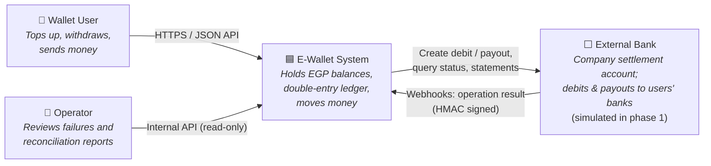
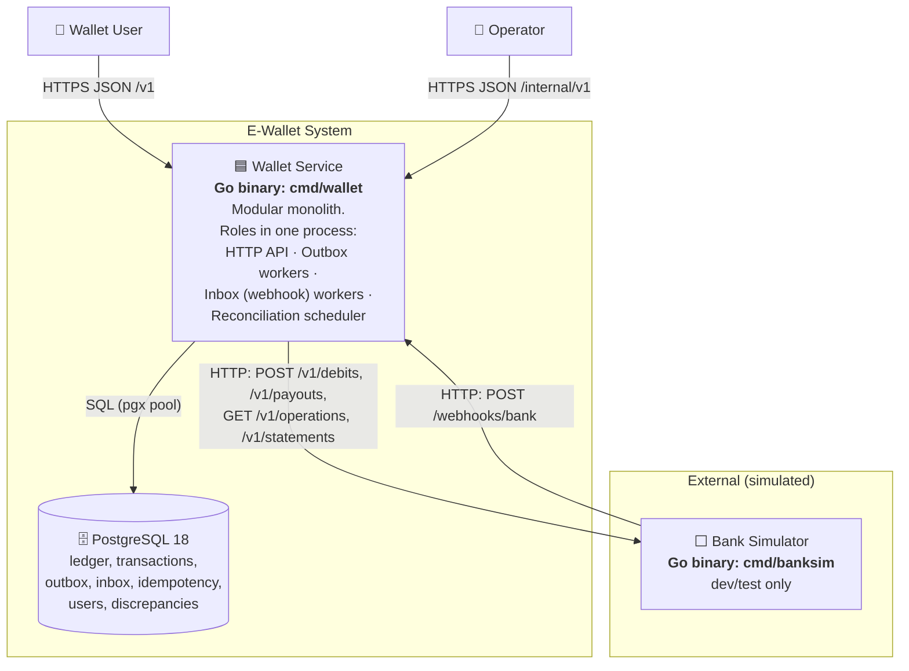
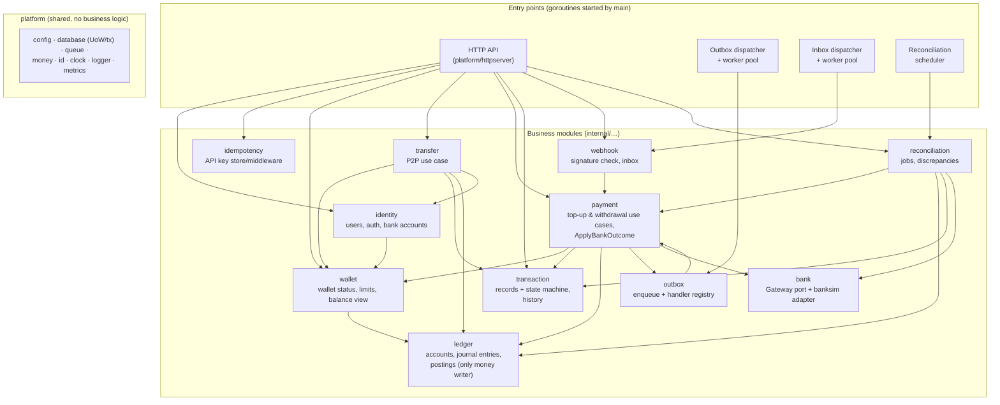
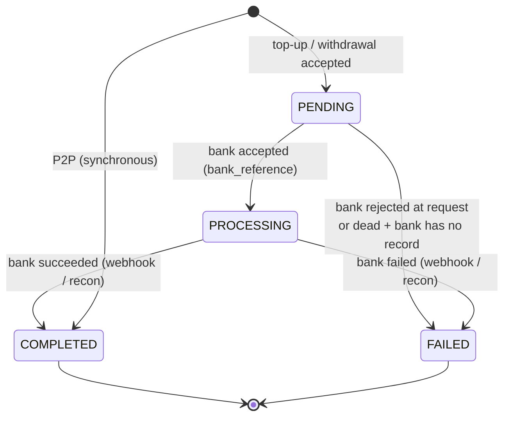
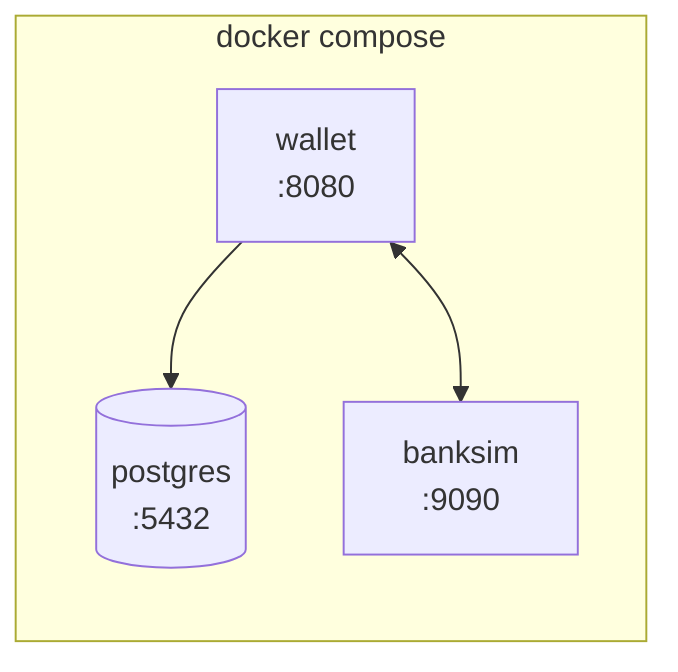

# E-Wallet — System Architecture (C4 Model)

| Field   | Value |
|---------|-------|
| Status  | Proposed — awaiting review |
| Date    | 2026-11-03 |
| Sources | PRD-001…004, TDR-001…013 |

This document describes the system using the [C4 model](https://c4model.com):
**Level 1 Context → Level 2 Containers → Level 3 Components → Level 4 Code**, followed by the
runtime flows and failure handling. Diagrams are Mermaid (render on GitHub / most IDEs).

---

## 1. Level 1 — System Context



| Element | Responsibility |
|---------|----------------|
| Wallet User | Uses the public API (through a future app). |
| Operator | Internal staff; reads discrepancies and failed transactions. |
| E-Wallet System | **The system we build.** Single source of truth for wallet balances. |
| External Bank | Holds the real money (company settlement account). Executes debits (top-up) and payouts (withdrawal) asynchronously and reports by webhook. Replaced by the **Bank Simulator** in phase 1. |

**Money backing rule:** Σ(all user wallet balances) + Σ(withdrawals in transit) = balance of
the company settlement account at the bank. Reconciliation proves this daily.

---

## 2. Level 2 — Containers



| Container | Technology | Responsibility | Decided in |
|-----------|-----------|----------------|-----------|
| Wallet Service | Go, `net/http`, pgx, goroutines | All business logic, API, background processing | TDR-001, TDR-012 |
| PostgreSQL | PostgreSQL 18 | System of record (ledger) and durable queues (outbox/inbox) | TDR-002 |
| Bank Simulator | Go, in-memory state | Stands in for the external bank; scripted scenarios | TDR-008 |

There is **one** service of ours. Scaling = more replicas of the same binary; roles can be
toggled by env (`API_ENABLED`, `OUTBOX_ENABLED`, `INBOX_ENABLED`, `RECON_ENABLED`). Multiple
replicas are safe because queues use `SKIP LOCKED` and jobs use advisory locks.

---

## 3. Level 3 — Components (inside the Wallet Service)



### 3.1 Component responsibilities

| Module | Owns tables | Exposes (examples) | Must not |
|--------|-------------|--------------------|----------|
| `identity` | `users`, `bank_accounts` | `Register`, `Login`, `GetUserByPhone`, `GetBankAccount` | touch money |
| `wallet` | `wallets` | `Open(tx, userID)`, `GetForUpdate(tx, …)`, `CheckLimits`, `View` | write postings |
| `ledger` | `ledger_accounts`, `journal_entries`, `postings` | `Post(tx, Entry)`, `LockAccounts(tx, ids)`, `Balance`, `VerifyIntegrity` | know about banks or HTTP |
| `transaction` | `transactions` | `Create(tx, …)`, `Transition(tx, id, from, to)`, `FindByBankRef`, `ListForUser` | post money |
| `payment` | — (orchestrator) | `RequestTopUp`, `RequestWithdrawal`, outbox handlers, `ApplyBankOutcome` | call the bank inside a DB tx |
| `transfer` | — (orchestrator) | `Send` | call the bank |
| `idempotency` | `idempotency_keys` | middleware, `Begin/Complete(tx, …)` | — |
| `outbox` | `outbox_events` | `Enqueue(tx, Event)`, `Register(type, handler)`, `Run(ctx)` | contain business rules |
| `webhook` | `inbox_events` | HTTP handler, `Run(ctx)` workers | change money directly (calls `payment`) |
| `reconciliation` | `job_runs`, `reconciliation_discrepancies` | `Run(ctx)` scheduler, jobs, discrepancy queries | edit ledger history |
| `bank` | — | `Gateway` interface + adapters | leak HTTP details to callers |

### 3.2 Dependency rules
- Arrows above are the **only** allowed import directions; enforced with `depguard` in CI.
- `ledger` and `platform` depend on nothing in business modules.
- Orchestrators (`payment`, `transfer`, `reconciliation`) open the DB transaction (unit of
  work) and pass `pgx.Tx` to module services. This is how state change + ledger + outbox commit
  atomically (TDR-001 §3).

---

## 4. Level 4 — Code (structure and key abstractions)

Full layout in TDR-012. Key abstractions:

```text
// platform/database — unit of work
func (db *DB) InTx(ctx, opts, fn func(ctx context.Context, tx pgx.Tx) error) error
    // begins tx, SET LOCAL lock_timeout/statement_timeout, runs fn,
    // retries on 40001/40P01/lock timeout (TDR-010), commits or rolls back

// ledger
type Entry struct {
    TransactionID uuid.UUID
    Type          EntryType          // TOPUP_SETTLE, WITHDRAWAL_RESERVE, …
    Postings      []Posting          // must balance; validated before insert
}
func (s *Service) Post(ctx, tx pgx.Tx, e Entry) error

// transaction — state machine
// PENDING → PROCESSING → COMPLETED | FAILED ; PENDING → FAILED ; P2P: created COMPLETED
func (s *Service) Transition(ctx, tx, id uuid.UUID, from, to Status, patch Patch) error

// payment — single entry point for bank results (webhook + reconciliation)
func (s *Service) ApplyBankOutcome(ctx, tx pgx.Tx, txnID uuid.UUID, o bank.Outcome) error

// outbox / inbox — generic DB queue
type Handler func(ctx context.Context, ev Event) Result   // Done | Retry(err) | Fail(reason)
```

---

## 5. Runtime Flows

### 5.1 Top-up (PRD-002)

```mermaid
sequenceDiagram
    autonumber
    actor U as User
    participant API as Wallet API
    participant DB as PostgreSQL
    participant OW as Outbox worker
    participant B as Bank (sim)
    participant WH as Webhook endpoint
    participant IW as Inbox worker

    U->>API: POST /v1/topups (Idempotency-Key)
    API->>DB: BEGIN; idempotency key; transaction PENDING; outbox topup.requested; COMMIT
    API-->>U: 202 {transaction_id, PENDING}
    OW->>DB: claim event (FOR UPDATE SKIP LOCKED)
    OW->>B: POST /v1/debits (Idempotency-Key = transaction_id)
    B-->>OW: 202 {bank_reference}
    OW->>DB: transaction → PROCESSING, bank_reference; event DONE
    Note over B: async processing (delay)
    B->>WH: POST /webhooks/bank debit.succeeded (signed)
    WH->>DB: INSERT inbox_events ON CONFLICT DO NOTHING
    WH-->>B: 200 OK
    IW->>DB: claim inbox event
    IW->>DB: BEGIN; lock txn; ApplyBankOutcome: post Dr BANK_SETTLEMENT / Cr USER_WALLET; → COMPLETED; COMMIT
```

### 5.2 Withdrawal (PRD-003)

```mermaid
sequenceDiagram
    autonumber
    actor U as User
    participant API as Wallet API
    participant DB as PostgreSQL
    participant OW as Outbox worker
    participant B as Bank (sim)
    participant IW as Inbox worker

    U->>API: POST /v1/withdrawals (Idempotency-Key)
    API->>DB: BEGIN; lock wallet account FOR UPDATE; check balance & limits
    API->>DB: transaction PENDING; post Dr USER_WALLET / Cr WITHDRAWALS_IN_TRANSIT; outbox; COMMIT
    API-->>U: 202 {transaction_id, PENDING} (balance already reduced)
    OW->>B: POST /v1/payouts (Idempotency-Key = transaction_id)
    B-->>OW: 202 {bank_reference}
    OW->>DB: → PROCESSING
    B->>IW: (via webhook + inbox) payout.succeeded / payout.failed
    alt succeeded
        IW->>DB: post Dr WITHDRAWALS_IN_TRANSIT / Cr BANK_SETTLEMENT; → COMPLETED
    else failed
        IW->>DB: post Dr WITHDRAWALS_IN_TRANSIT / Cr USER_WALLET (refund); → FAILED
    end
```

### 5.3 P2P transfer (PRD-004)

```mermaid
sequenceDiagram
    autonumber
    actor S as Sender
    participant API as Wallet API
    participant DB as PostgreSQL
    S->>API: POST /v1/transfers (Idempotency-Key)
    API->>DB: BEGIN; idempotency key; lock sender+recipient accounts ORDER BY id FOR UPDATE
    API->>DB: validate; transaction P2P COMPLETED; post Dr SENDER / Cr RECIPIENT; COMMIT
    API-->>S: 201 {COMPLETED, balance_after_minor}
```

### 5.4 Reconciliation of a lost webhook (TDR-009)

```mermaid
sequenceDiagram
    autonumber
    participant SCH as Scheduler (ticker)
    participant DB as PostgreSQL
    participant B as Bank (sim)
    SCH->>DB: pg_try_advisory_lock(pending_bank_ops)
    SCH->>DB: find PROCESSING > 10 min
    loop each transaction
        SCH->>B: GET /v1/operations/{transaction_id}
        B-->>SCH: SUCCEEDED / FAILED / PENDING / NOT_FOUND
        SCH->>DB: ApplyBankOutcome (same code as webhook) or mark checked
    end
    SCH->>DB: record job_run; release lock
```

### 5.5 Transaction state machine



---

## 6. Failure Handling Matrix

| Failure | Where | Protection | Result |
|---------|-------|------------|--------|
| User double click / client retry | API | Idempotency key (TDR-005 L1/L2) | One transaction; same response replayed |
| Parallel spend on same wallet | API | `FOR UPDATE` + `CHECK balance>=0` (TDR-010) | Never negative |
| A↔B concurrent P2P | API | Ordered locking | No deadlock |
| Crash after commit, before bank call | Outbox | Event persisted; lease expiry reclaims | Bank called after restart |
| Bank timeout / 5xx | Outbox worker | Retry w/ backoff, same bank idempotency key | Executed once at bank |
| Bank down for long | Outbox | `DEAD` after max attempts → recon `dead_outbox` | Failed (+refund) only if bank has no record |
| Duplicate webhook | Webhook | Inbox unique event ID + state machine + ledger unique (transaction_id, entry_type) | Applied once |
| Webhook lost | Recon | `pending_bank_ops` queries bank | Completed within ~11–15 min |
| Webhook before outbox saved bank_reference | Inbox | Match by idempotency key; retry if unknown | Applied correctly |
| Invalid webhook signature | Webhook | HMAC + timestamp window | Rejected 401 |
| Contradicting bank result after terminal | Payment | Discrepancy, no auto-fix | Operator review |
| Amount mismatch from bank | Payment | Discrepancy, no posting | Operator review |
| Ledger / bank balance drift | Recon | Integrity + daily settlement jobs | Discrepancy + alert |
| Deploy / SIGTERM mid-work | All roles | Graceful shutdown, leases, idempotent handlers | Work resumes |

---

## 7. Deployment View (phase 1, local)



Config (env): `DATABASE_URL`, `HTTP_ADDR`, `JWT_SECRET`, `BANK_BASE_URL`, `BANK_WEBHOOK_SECRET`,
`OUTBOX_WORKERS`, `INBOX_WORKERS`, `OUTBOX_MAX_ATTEMPTS`, `RECON_PROCESSING_THRESHOLD`,
role flags, limits (PRD-001 §5.6).

---

## 8. Cross-Cutting Concerns

| Concern | Approach |
|---------|----------|
| Logging | `slog` JSON; fields `request_id`, `user_id`, `transaction_id`, `event_id`, `job` |
| Metrics | Prometheus: HTTP latency, outbox/inbox depth & age, bank call results, recon breaks, ledger integrity status |
| Health | `/healthz` (process up), `/readyz` (DB reachable, migrations applied) |
| Security | JWT auth, bcrypt, HMAC webhooks, internal API key, strict JSON, no secrets in repo |
| Testing | Unit (fake gateway), integration (testcontainers Postgres), e2e (compose + banksim scenarios), concurrency tests, ledger integrity assertion after each test |

---

## 9. Future Evolution (not decided for phase 1)
- Message broker relay behind the outbox (TDR-006).
- Real bank adapter replacing banksim (TDR-008).
- External scheduler (K8s CronJob) for reconciliation (TDR-009).
- External IdP, OTP (TDR-011).
- Fees, multi-currency (TDR-003, TDR-004 designed to allow it).
