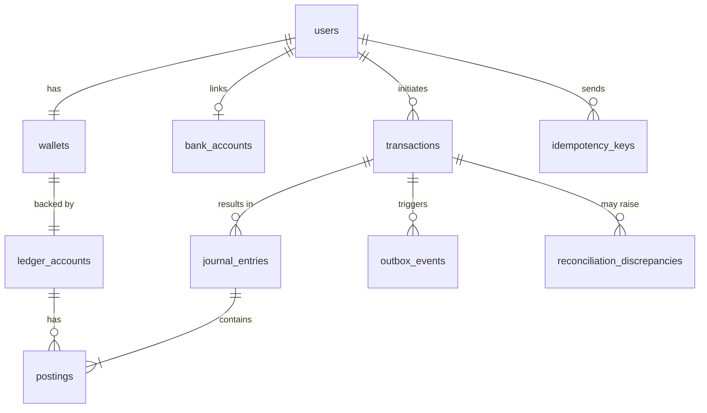

# E-Wallet — Data Model (PostgreSQL)

| Field   | Value |
|---------|-------|
| Status  | Accepted (2026-11-05, phase-1 roadmap planning) |
| Date    | 2026-11-03 |
| Sources | TDR-002, TDR-003, TDR-004, TDR-005, TDR-006, TDR-007, TDR-009 |

Logical model only. Real DDL lives in `migrations/` once implementation starts.
Conventions: PK `id UUID` (v7), money `BIGINT` piasters, `currency CHAR(3) = 'EGP'`,
timestamps `timestamptz` UTC.

## 1. Ownership

| Table | Owner module |
|-------|--------------|
| `users`, `bank_accounts` | identity |
| `wallets` | wallet |
| `ledger_accounts`, `journal_entries`, `postings` | ledger |
| `transactions` | transaction |
| `idempotency_keys` | idempotency |
| `outbox_events`, `outbox_events_archive` | outbox |
| `inbox_events` | webhook |
| `job_runs` | reconciliation |
| `reconciliation_discrepancies` | discrepancy (decided 2026-11-05; see TDR-009 §3) |

## 2. ER Diagram

## 3. Tables

### users
| Column | Type | Notes |
|--------|------|-------|
| id | uuid PK | |
| phone_e164 | text UNIQUE NOT NULL | `+20…` |
| full_name | text NOT NULL | |
| password_hash | text NOT NULL | bcrypt |
| status | text NOT NULL | `ACTIVE` / `DISABLED` |
| created_at | timestamptz | |

### bank_accounts
| Column | Type | Notes |
|--------|------|-------|
| id | uuid PK | |
| user_id | uuid UNIQUE FK users | one per user (Q4) |
| iban | text NOT NULL | EG IBAN, 29 chars, checksum validated |
| holder_name | text NOT NULL | |
| created_at, updated_at | timestamptz | |

### wallets
| Column | Type | Notes |
|--------|------|-------|
| id | uuid PK | |
| user_id | uuid UNIQUE FK users | one wallet per user |
| ledger_account_id | uuid UNIQUE FK ledger_accounts | |
| currency | char(3) | `EGP` |
| status | text | `ACTIVE` / `FROZEN` |
| created_at, updated_at | timestamptz | |

### ledger_accounts
| Column | Type | Notes |
|--------|------|-------|
| id | uuid PK | |
| code | text UNIQUE | `USER_WALLET:{wallet_id}`, `BANK_SETTLEMENT`, `WITHDRAWALS_IN_TRANSIT`, `SUSPENSE` |
| kind | text | `USER_WALLET` / `SYSTEM` |
| type | text | `ASSET` / `LIABILITY` |
| normal_side | text | `DEBIT` / `CREDIT` |
| currency | char(3) | |
| balance | bigint NOT NULL DEFAULT 0 | cached, signed in normal side; `CHECK (kind <> 'USER_WALLET' OR balance >= 0)` |
| version | bigint NOT NULL DEFAULT 0 | |
| created_at, updated_at | timestamptz | |

### journal_entries (append-only)
| Column | Type | Notes |
|--------|------|-------|
| id | uuid PK | |
| transaction_id | uuid FK transactions NOT NULL | |
| entry_type | text | `TOPUP_SETTLE`, `WITHDRAWAL_RESERVE`, `WITHDRAWAL_SETTLE`, `WITHDRAWAL_REFUND`, `P2P`, `ADJUSTMENT` |
| description | text | |
| created_at | timestamptz | |
| | | `UNIQUE (transaction_id, entry_type)` |

### postings (append-only)
| Column | Type | Notes |
|--------|------|-------|
| id | uuid PK | |
| journal_entry_id | uuid FK | |
| account_id | uuid FK ledger_accounts | |
| direction | text | `DEBIT` / `CREDIT` |
| amount | bigint | `CHECK (amount > 0)` |
| currency | char(3) | |
| balance_after | bigint | account balance after this posting |
| created_at | timestamptz | |
| | | Index `(account_id, created_at)`; deferred trigger: Σdebit = Σcredit per entry; trigger blocks UPDATE/DELETE |

### transactions
| Column | Type | Notes |
|--------|------|-------|
| id | uuid PK | also the bank idempotency key |
| type | text | `TOPUP` / `WITHDRAWAL` / `P2P` |
| status | text | `PENDING` / `PROCESSING` / `COMPLETED` / `FAILED` |
| initiator_user_id | uuid FK users | |
| source_wallet_id | uuid NULL | withdrawal, P2P |
| destination_wallet_id | uuid NULL | top-up, P2P |
| amount | bigint | `CHECK (amount > 0)` |
| currency | char(3) | |
| idempotency_key | text NOT NULL | `UNIQUE (initiator_user_id, idempotency_key)` |
| bank_reference | text NULL UNIQUE | from bank |
| bank_account_snapshot | jsonb NULL | IBAN/holder used at request time |
| note | text NULL | P2P, ≤140 |
| failure_code, failure_message | text NULL | |
| last_reconciled_at | timestamptz NULL | |
| created_at, updated_at, completed_at | timestamptz | |
| | | Indexes: `(status, updated_at)` partial non-terminal; `(source_wallet_id, created_at desc)`; `(destination_wallet_id, created_at desc)` |

### idempotency_keys
| Column | Type | Notes |
|--------|------|-------|
| user_id, key | PK (uuid, text) | |
| method, path | text | |
| request_hash | bytea | SHA-256 |
| status | text | `IN_PROGRESS` / `COMPLETED` |
| response_status | int | |
| response_body | jsonb | |
| transaction_id | uuid NULL | |
| created_at, expires_at | timestamptz | index on `expires_at` |

### outbox_events / inbox_events
See TDR-006 §1 and TDR-007 §2. Shared shape: `id, type, payload jsonb, status, attempts,
next_attempt_at, locked_by, locked_until, last_error, created_at/received_at, processed_at`.
Outbox adds `aggregate_type, aggregate_id`; inbox adds `provider, provider_event_id`
(`UNIQUE (provider, provider_event_id)`).

### job_runs
`id, job_name, started_at, finished_at, status (SUCCESS | FAILED | SKIPPED), items_checked,
items_fixed, error`.

### reconciliation_discrepancies
See TDR-009 §3.

## 4. Invariants (checked by DB, code, and the integrity job)
1. Every journal entry balances (Σdebit = Σcredit).
2. Σ of all postings' debits = Σ of all credits.
3. `ledger_accounts.balance` = balance computed from its postings.
4. User wallet balance ≥ 0.
5. `WITHDRAWALS_IN_TRANSIT.balance` = Σ amount of withdrawals in `PENDING`/`PROCESSING`.
6. A `COMPLETED` top-up has exactly one `TOPUP_SETTLE` entry; a `PENDING`/`PROCESSING`/`FAILED` top-up has none.
7. A `COMPLETED` withdrawal has `WITHDRAWAL_RESERVE` + `WITHDRAWAL_SETTLE`; a `FAILED` one has `WITHDRAWAL_RESERVE` + `WITHDRAWAL_REFUND` (or nothing if rejected before reserve).
8. Ledger rows are never updated or deleted.
