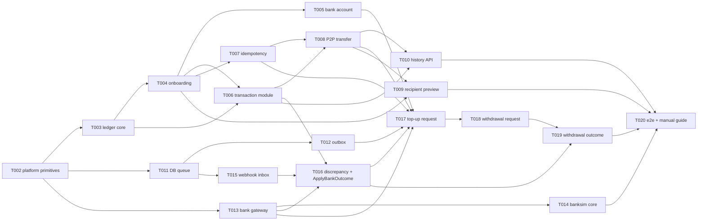

# Roadmap — Top-up, Withdrawal and P2P End to End

| Field   | Value |
|---------|-------|
| Status  | Accepted (2026-11-05) |
| Owner   | Yahya Elaraby |
| Sources | PRD-001…004, TDR-001…016, `architecture.md`, `data-model.md` |

**Goal of phase 1:** the three wallet flows (top-up, withdrawal, P2P) run end to end on the
local compose stack (`wallet` + `postgres` + `banksim`), and a person can test them by hand:
register, link a bank account, top up, send money to another user, and withdraw. That includes
the success path, bank rejection, duplicate requests (idempotency), duplicate webhooks and bank
retries.

**Phase 2** adds self-healing: reconciliation jobs, the simulator's fault scenarios, and the
operator API. Until phase 2 is done, a lost webhook or a `DEAD` outbox event leaves a transaction
non-terminal (and a withdrawal's money stays reserved, which is safe). Phase 1 never gets this
wrong; it just doesn't fix it on its own yet.

## How we work
- One task = one responsibility = one PR, planned with `/plan-new-task TNNN` right before it is
  implemented. Each task's plan uses what the tasks before it actually built.
- Every phase-1 task now has a full `task.md` (all `Ready`, planned 2026-11-05). The sketches below
  are kept as the overview; **the task.md is the spec** and wins if they differ. The "Decide when
  planning" questions were all answered (see each task's Decisions Log).
- Each module task adds its own `depguard` rules (architecture §3.2), its own migrations, and its
  part of `api/openapi/wallet.yaml`.

## Decisions taken for this roadmap (2026-11-05)
| Decision | Docs |
|----------|------|
| PRD-001…004 and TDR-003…011 accepted; Q1–Q7 answered with the proposed answers | PRDs, TDRs, `docs/README.md` |
| Phase 1 = the three flows end to end; reconciliation, fault scenarios and the operator API = phase 2 | this file |
| New `discrepancy` module owns `reconciliation_discrepancies` | TDR-016, TDR-007, TDR-009, architecture, data model |
| PRD-002 §7 reconciliation query aligned to `GET /v1/operations/{key}` (TDR-008) | PRD-002 |
| Money: `New` allows any sign, `NewPositive` for movements | TDR-003 |
| Tx timeouts/retries as config (`DB_LOCK_TIMEOUT`, `DB_STATEMENT_TIMEOUT`, `DB_TX_MAX_RETRIES`), 10–50 ms jitter | TDR-010 |
| sqlc per module into `internal/<m>/internal/sqlcgen`, checked in CI | T003 |
| New status codes 413/429; idempotency lock wait → 409 (not retried) | TDR-017 |
| `webhook → payment` and history name lookups through interfaces wired in `main` | architecture §3.2 |
| Outbox archive janitor, banksim settlement balance + statements, `bank.GetStatement` → phase 2 | T012, T013, T014 |

## Dependency graph (phase 1)

T011–T015 (bank plumbing) do not depend on T005–T010, so they can be built in parallel with the P2P track.

## Phase 1 tasks

### Foundations

**T002 — Platform primitives for money code** · depends on T001
`platform/money` (int64 piasters, `New`/`NewPositive`, overflow-checked `Add`/`Sub`, `Format`),
`platform/id` (UUIDv7), `platform/clock` (`Clock`, `System`, `clocktest.Fake`, Africa/Cairo
business day), `database.DB` with `InTx` (lock/statement timeouts, retry on 40001/40P01/55P03 →
`ErrTryAgain`). TDR-003, TDR-010, TDR-013.

**T003 — Ledger core** · depends on T002
Migration for `ledger_accounts`, `journal_entries`, `postings` (CHECKs, `UNIQUE (transaction_id,
entry_type)`, a deferred balance trigger, a trigger blocking UPDATE/DELETE), seed of the system
accounts (`BANK_SETTLEMENT`, `WITHDRAWALS_IN_TRANSIT`, `SUSPENSE`). `ledger.Service`:
`CreateUserAccount`, `LockAccounts` (ordered `FOR UPDATE`), `Post` (balanced, updates cached
balance and `balance_after`, atomic update of system accounts), `Balance`, `VerifyIntegrity`
(TDR-004 §6 items 1–2), plus a test helper that asserts integrity after each scenario. Sets up
**sqlc** (`sqlc.yaml`, generate target, CI check that the generated code is up to date).
TDR-004, TDR-010.
*Decide when planning:* the FK `journal_entries.transaction_id → transactions` comes later
(T006 migration adds it) — confirm; whether `ADJUSTMENT` posting is exposed now or in phase 2.

**T004 — Onboarding: register, login, my wallet** · depends on T003
`identity` (`users`, bcrypt, `POST /v1/auth/register`, `POST /v1/auth/login`, JWT HS256 + auth
middleware), `wallet` (`wallets`, `Open(tx, userID)` creating the `USER_WALLET` ledger account in
the same DB tx as the user, `GET /v1/me/wallet`). Strict JSON decoding helper (unknown fields,
64 KB, integers only) and the start of `api/openapi/wallet.yaml`. PRD-001 US-1..3, BR-5, TDR-011, TDR-013.
*Decide when planning:* `JWT_TTL` configurable (15 min default) for easier manual testing; login
rate-limit numbers; password rules beyond min 8; phone normalization rules for `+20`.

**T005 — Bank account linking** · depends on T004
`bank_accounts`, `PUT /v1/me/bank-account` (create or replace), EG IBAN validation (29 chars,
ISO 13616 mod-97), `identity.GetBankAccount`. PRD-001 US-6, Q4.
*Decide when planning:* can the account be replaced while a top-up/withdrawal is in flight (the
transaction stores a snapshot, so probably yes); `GET /v1/me/bank-account`?; holder-name rules.

**T006 — Transaction module** · depends on T003, T004
`transactions` table (data model), FK from `journal_entries`, `transaction.Service`: `Create`,
`Get`, `GetForUpdate`, `Transition` (state machine §5.5, invalid transitions are errors),
`FindByBankRef`, `SetBankReference`; sum helpers for limits (outgoing per Cairo day, pending top-ups).
PRD-001 BR-11, BR-14, BR-15.
*Decide when planning:* where the sum helpers live (transaction vs wallet `CheckLimits`).

**T007 — API idempotency** · depends on T004
`idempotency_keys`, `idempotency.Begin/Complete(tx, …)` inside the business DB tx, request-hash of
the canonical body, replay with `Idempotent-Replayed: true`, `422 IDEMPOTENCY_KEY_REUSED`,
`409 REQUEST_IN_PROGRESS` on lock timeout, `400 IDEMPOTENCY_KEY_REQUIRED`, hourly cleanup goroutine.
TDR-005 L1, PRD-001 BR-16..18.
*Decide when planning:* middleware vs explicit helper called by each handler (it must share
the business tx); what counts as the "canonical" JSON for the hash.

### P2P (hand-testable once top-up exists; integration-tested from the start)

**T008 — P2P transfer** · depends on T006, T007
`transfer.Send`, `POST /v1/transfers`, limit config (all PRD-001 §5.6 env vars), daily outgoing
limit (Cairo day, withdrawals `PENDING/PROCESSING/COMPLETED` + P2P), ordered locks, `201` with
`balance_after_minor`, all PRD-004 §3 errors, `503 TRY_AGAIN`. PRD-004, TDR-010.
*Decide when planning:* the exact response body (masked recipient name format), what happens
to the note's whitespace/empty string.

**T009 — Recipient preview** · depends on T004
`GET /v1/recipients?phone=` → masked name only. PRD-004 Q7.
*Decide when planning:* masking format; 404 vs 200 for an unknown phone; self lookup.

**T010 — Transaction history API** · depends on T008
`GET /v1/me/transactions` (cursor pagination, newest first, direction IN/OUT, counterparty for
P2P) and `GET /v1/transactions/{id}` (only the initiator or the P2P counterparty may read it).
PRD-001 US-4, US-5, TDR-013.
*Decide when planning:* the cursor format; filters (type/status) or none; 404 vs 403 for other users' transactions.

### Bank plumbing (can run in parallel with T005–T010)

**T011 — Generic DB queue** · depends on T002
`platform/queue`: claim batch with `FOR UPDATE SKIP LOCKED` + lease, dispatcher + fixed worker
pool, `Done | Retry(err) | Fail(reason)` results, exponential backoff with full jitter (base 1 s,
cap 5 min), `DEAD` after max attempts, wake-up channel, graceful stop. Table-agnostic, used by
outbox and inbox. TDR-006 §2–3, §5.
*Decide when planning:* how the queue is parameterized per table (table name + column set vs a
small store interface each owner implements).

**T012 — Outbox module** · depends on T011
`outbox_events` (+ archive table), `outbox.Enqueue(tx, Event)`, handler registry, `Run(ctx)` with
role flag `OUTBOX_ENABLED`, `OUTBOX_WORKERS`, `OUTBOX_MAX_ATTEMPTS`, metrics (TDR-006 §6),
archive janitor. TDR-006.
*Decide when planning:* whether the archive janitor is in phase 1 or 2.

**T013 — Bank gateway port + banksim adapter** · depends on T002
`internal/bank`: `Gateway` (`CreateDebit`, `CreatePayout`, `GetOperation`; `GetStatement` waits
for phase 2), `ErrRejected{Code,Message}` vs `ErrTemporary`, HTTP adapter `bank/banksim`
(`BANK_BASE_URL`, timeout), in-process fake for unit tests, `api/openapi/banksim.yaml`. TDR-008 §1.
*Decide when planning:* HTTP client timeout value; how 409/404 from the bank map to errors.

**T014 — Bank simulator core** · depends on T013 (contract)
`internal/banksim` + `cmd/banksim`: `POST /v1/debits`, `POST /v1/payouts`,
`GET /v1/operations/{key}`, idempotent by `Idempotency-Key`, in-memory state, async webhook
after a delay signed with HMAC (`X-Bank-Signature`), scenarios by IBAN suffix `…0000` (success),
`…0001` (rejection by webhook), `…0002` (sync 422), `/admin/scenarios`; compose env
(`BANKSIM_WEBHOOK_URL`, `BANK_WEBHOOK_SECRET`, base delay). TDR-008 §2–3, TDR-007 §1, §4.
*Decide when planning:* webhook retry policy of the simulator when the wallet returns 5xx; base
delay default; whether the settlement balance endpoint comes now.

**T015 — Webhook ingestion (inbox)** · depends on T011
`POST /webhooks/bank` (HMAC + 5-minute window → 401, envelope parse, `INSERT … ON CONFLICT DO
NOTHING`, fast 200), `inbox_events`, inbox workers (`INBOX_ENABLED`, `INBOX_WORKERS`) that hand
each event to a registered processor; an unknown transaction → retry then `DEAD`. TDR-007.
*Decide when planning:* processor interface shape (so `webhook` does not need `payment` until T016 wires it).

### Top-up and withdrawal

**T016 — Discrepancy module + ApplyBankOutcome (debits)** · depends on T006, T015
`internal/discrepancy` (TDR-016: table, `Record`, `List`), `payment.ApplyBankOutcome` for
top-ups: lock txn, terminal same → no-op, terminal different → discrepancy, amount mismatch →
discrepancy, success → `TOPUP_SETTLE` posting + `COMPLETED`, failure → `FAILED`. Wired as the
inbox processor; `UNKNOWN_BANK_EVENT` discrepancy for dead inbox events. PRD-002 TU-BR-1..4, TDR-007 §3.
*Decide when planning:* failure_code/message mapping shown to the user.

**T017 — Top-up request** · depends on T005, T007, T012, T013, T016
`POST /v1/topups` (all PRD-002 §3 checks incl. balance + pending top-ups ≤ max, one DB tx:
idempotency + `TOPUP PENDING` + outbox `topup.requested` + bank-account snapshot, `202`),
outbox handler `topup.requested` → `CreateDebit` → `PROCESSING` + `bank_reference`, or `FAILED`
on `ErrRejected`, retry on `ErrTemporary`. **After this task, top-up works end to end with banksim.**
PRD-002, TDR-006 §3.
*Decide when planning:* lock the wallet account during the max-balance check (concurrent
top-ups); frozen-wallet error order vs other validations.

**T018 — Withdrawal request** · depends on T017
`POST /v1/withdrawals` (lock, balance, limits incl. daily outgoing, `WITHDRAWAL_RESERVE` posting,
outbox `withdrawal.requested`, `202`), outbox handler → `CreatePayout` → `PROCESSING`, or on sync
rejection `FAILED` + `WITHDRAWAL_REFUND` in one tx. PRD-003 WD-BR-1, 4..7, TDR-010.

**T019 — Withdrawal outcome** · depends on T018
`ApplyBankOutcome` for payouts: success → `WITHDRAWAL_SETTLE` + `COMPLETED`; failure →
`WITHDRAWAL_REFUND` + `FAILED`; late/contradicting → discrepancy. **After this task, withdrawal
works end to end.** PRD-003 WD-BR-2, 3, 8, 9.

**T020 — End-to-end suite + manual test guide** · depends on T010, T014, T019
`test/e2e` against compose: the three flows, rejections (`…0001`, `…0002`), double-click,
parallel overspend, duplicate webhook (re-POST of a captured webhook), ledger integrity after
each scenario. `docs/engineering/manual-testing.md`: step-by-step `curl` walkthrough (register 2
users, link IBANs, top up, P2P, withdraw, check history). Final compose env review. PRD-001 §9.

## Phase 2 — Resilience (planned after phase 1)
| # | Task | Sources |
|---|------|---------|
| P2-1 | Banksim fault scenarios `…0003`–`…0009`, statements, settlement balance, `bank.GetStatement`, outbox archive janitor | TDR-008 §3, TDR-006 §5 |
| P2-2 | Reconciliation scheduler (advisory lock, `job_runs`, `RECON_ENABLED`) + `pending_bank_ops` job + `wallet reconcile --job` | TDR-009 §1–2, PRD-002/003 §7 |
| P2-3 | `dead_outbox` and `stuck_alert` jobs (`BANK_UNAVAILABLE` failure + refund) | TDR-009, PRD-002 TU-BR-7, PRD-003 WD-BR-4 |
| P2-4 | `ledger_integrity` and `daily_settlement` jobs, `GetStatement` | TDR-004 §6, TDR-009 |
| P2-5 | Operator API `GET /internal/v1/discrepancies` with internal API key | TDR-009 §3, TDR-011 |
| P2-6 | Resilience e2e: lost webhook, bank timeout ×3, 503 backoff, crash between commit and bank call | PRD-001 §9, PRD-002 AC-6..8 |
